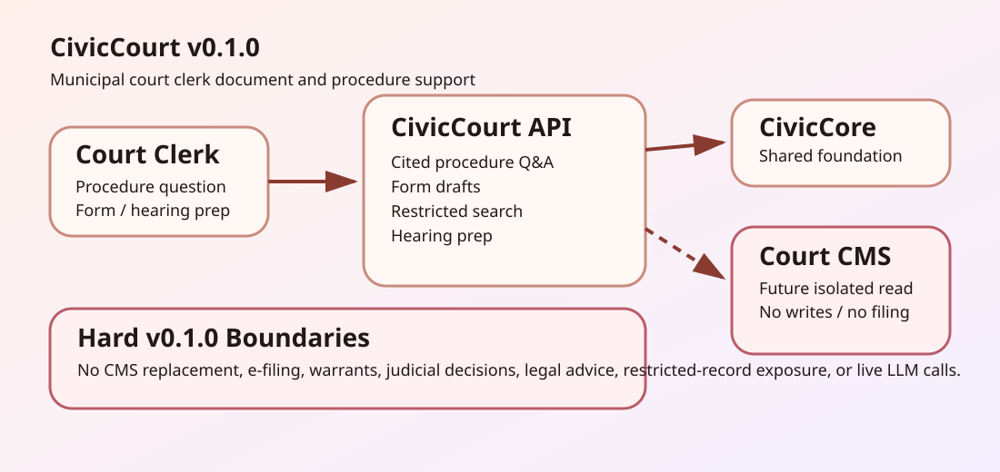

# Townlight Courts Architecture

Townlight Courts v0.1.0 is a deterministic FastAPI module over Townlight Core. It provides municipal court clerk support while explicitly avoiding case-management-system replacement and high-risk decision surfaces.

## Shipped

- Court procedure answer drafts with citations.
- Court form draft scaffolds for clerk review.
- Restricted-record-aware sample search.
- Hearing preparation checklists.
- Public sample UI and release gates.

## Not Shipped

- Court case management.
- E-filing or document filing.
- Warrant issuance.
- Judicial decisions.
- Legal advice.
- Sealed or juvenile record exposure.
- Live court CMS connectors.
- Live LLM calls.
